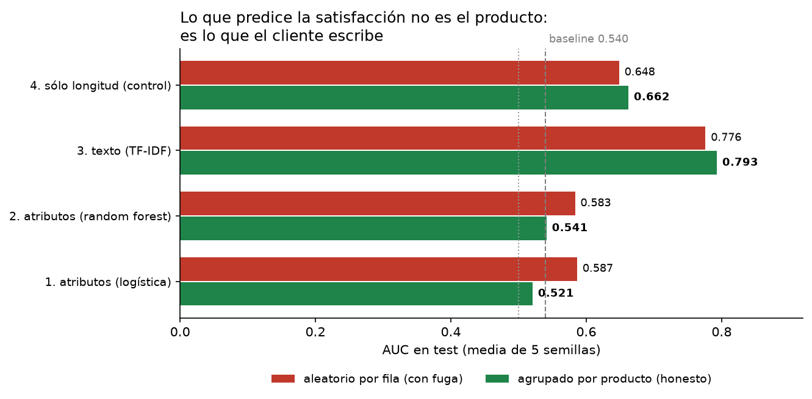
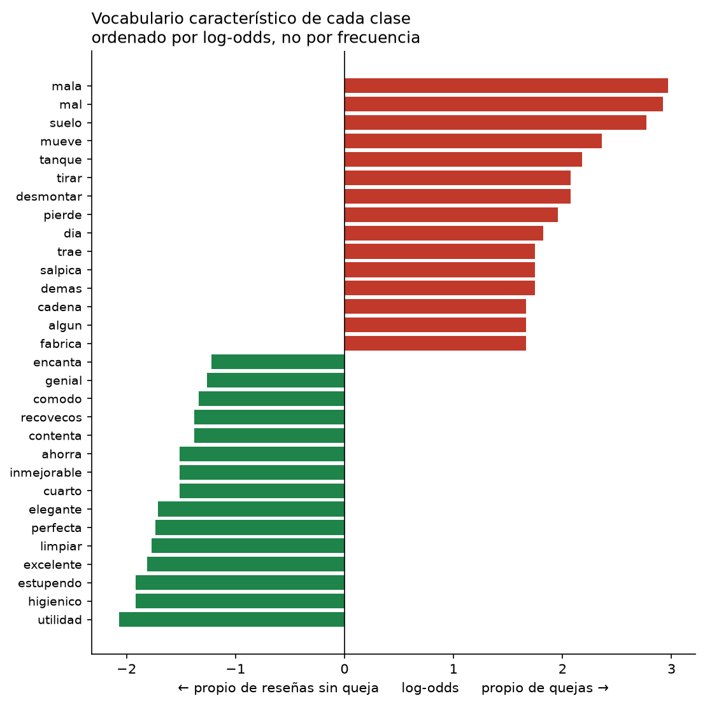

# Lo que predice la satisfacción no es el producto

**Análisis de 884 reseñas de inodoros de Leroy Merlin en español: comparación
rigurosa entre predecir la satisfacción con los atributos técnicos del
producto o con el texto que escribe el cliente.**

Proyecto hermano de [`tfg-leroy-merlin`](../TFG_LEROY_MERLIN_CORREGIDO), la
reconstrucción de mi TFG en R. Aquel trabajo modelaba la satisfacción a partir
de once atributos del producto y obtenía un AUC de 0,52 con una evaluación
honesta: **no generaliza**. Este proyecto comprueba si el problema era el
modelo o la pregunta.

---

## El resultado

| Modelo | AUC (split honesto) |
|---|---:|
| Baseline (clase mayoritaria) | 0,540 |
| **Atributos del producto** (los 11 del TFG) | **0,521** |
| Atributos, random forest | 0,541 |
| Control: sólo la longitud del comentario | 0,662 |
| **Texto de la reseña** (TF-IDF palabra + carácter) | **0,793** |



**El texto predice +0,27 de AUC por encima de los atributos.** El problema del
TFG no era el modelo: era que ningún modelo puede predecir la experiencia de
un cliente concreto a partir de las características de un catálogo.

### Por qué hay un modelo "control"

Sin él, cualquier mejora se atribuye al análisis de sentimiento. Un modelo con
**una sola variable** —cuántos caracteres escribió el cliente— ya alcanza 0,662:
la gente insatisfecha escribe más largo. El TF-IDF añade **+0,131** sobre ese
control, y ésa es la contribución real del contenido, no los +0,27 de titular.

Es el tipo de comprobación que separa un resultado de una ilusión.

---

## El protocolo de evaluación

Los dos modelos se evalúan **exactamente igual**, y es lo único que hace válida
la comparación:

- **5 semillas** (11, 42, 77, 2017, 123) — las mismas que la versión R
- **Dos estrategias de split**, aplicadas a los dos modelos:
  - `aleatorio`: por fila, como hacía el TFG. Mide 99,4 % de solape.
  - `por_producto`: `GroupShuffleSplit`. Ningún producto en los dos lados. Solape 0,0 %.
- **Mismas métricas**: AUC, accuracy, sensibilidad, especificidad
- La clase positiva es **la queja**, porque es la que le interesa a la tienda

El protocolo vive en [`src/evaluacion.py`](src/evaluacion.py), fuera de los
scripts, para que ningún modelo pueda usar el suyo propio.

> **Validación cruzada entre lenguajes:** el modelo de atributos da **0,521**
> aquí (scikit-learn) y **0,525** en la versión R (tidymodels). Son dos
> implementaciones independientes del mismo diseño, y coinciden. Eso es lo que
> da confianza en que el número es real y no un artefacto de una librería.

---

## Lo que dicen las reseñas

Ordenar por frecuencia no sirve: **5 de las 8 palabras más frecuentes son las
mismas en las dos clases** (muy, calidad, precio, bien, diseño) porque son el
vocabulario del dominio. Hay que usar log-odds.



**Quejas** — modos de fallo concretos, no opiniones vagas:

| Bigrama | log-odds |
|---|---:|
| mala calidad | +2,40 |
| **pierde agua** | +1,99 |
| **primer día** | +1,52 |
| toma agua | +1,52 |
| plástico muy… | +1,52 |

Y en unigramas: *mueve*, *salpica*, *desmontar*, *tanque*.

**Sin queja**: *elegante*, *limpiar*, *estupendo*, *inmejorable*, *ahorra*,
*recovecos* (de "sin recovecos", por el rimless).

> **Esto sí es accionable.** "Pierde agua el primer día" y "se mueve" son
> problemas de instalación y de montaje, no de diseño de producto. Un atributo
> de catálogo nunca iba a capturarlos.

---

## El techo del problema

De las 407 reseñas etiquetadas como queja, **246 son de 4 estrellas** (el 60 %),
y de ésas **139 (57 %) contienen vocabulario positivo**: *bien*, *buena*,
*recomiendo*, *me gusta*.

```
1★   66  ███████████
2★   24  ████
3★   71  ███████████
4★  246  █████████████████████████████████████████   <- "queja"
5★  477  ███████████████████████████████████████████████████████████████████████████████
```

La variable objetivo del TFG agrupa 1-4 estrellas como "queja". Es una decisión
defendible —en la escala de Leroy Merlin, menos de 5 señala algo que falla—
pero **mete ruido irreducible**: parte de las quejas no lo son. Ningún modelo
puede superar ese techo, y conviene decirlo antes de que lo pregunten.

---

## Decisiones técnicas que se pueden defender

**No se usa spaCy ni lematización.** El corpus son 884 reseñas de 97 caracteres
de media con faltas de ortografía reales ("guestado", "vater") y tildes
inconsistentes. Un lematizador entrenado en texto normativo acierta poco ahí.
En su lugar se combinan n-gramas de **palabra (1-2)** y de **carácter (3-5)**:
los de carácter absorben la morfología del español (roto/rota/rotos) y las
faltas sin necesidad de lematizar, y el repositorio se puede clonar y ejecutar
sin descargar 50 MB de modelos.

**La lista de stopwords excluye deliberadamente** *no, nada, nunca, poco, muy,
más, menos, bien, mal*. Las listas estándar las eliminan, y en análisis de
opiniones son justo las que distinguen "buena calidad" de "no es de buena
calidad". El resultado lo confirma: **`no` es el término con mayor coeficiente
de queja de todo el modelo** (+2,07).

**Sin búsqueda de hiperparámetros.** Con 884 filas, ajustar `C` dentro de cada
split añade varianza y poco más. El objetivo es comparar familias de variables,
no exprimir un modelo.

---

## Reproducir

> ### ⚠️ Este repositorio no se puede ejecutar sin los datos, y los datos no son públicos
>
> El dataset es propiedad de Leroy Merlin. Si clonas este repositorio, puedes
> leer el código y revisar los resultados —que están completos en
> [`output/`](output/), métrica a métrica y semilla a semilla— pero no
> reproducir la ejecución.
>
> Es una limitación real y se dice aquí en vez de esconderla en una nota al
> pie. El proyecto hermano en R sí trae un
> [generador sintético](../TFG_LEROY_MERLIN_CORREGIDO) para poder ejecutarse
> sin datos reales; aquí no se ha hecho equivalente porque habría que inventar
> el texto de las reseñas, y entonces el resultado del modelo de texto sería un
> artefacto de las plantillas inventadas en vez de un hallazgo.

```bash
pip install -r requirements.txt
python scripts/01_eda.py
python scripts/02_nlp_descriptivo.py
python scripts/03_atributos_vs_texto.py
```

El dataset lo genera el proyecto R (`Rscript --vanilla R/run_all.R` escribe
`data_interim/databoceto.csv`). Las tres uniones entre las cuatro fuentes de
Leroy Merlin **no se reimplementan aquí a propósito**: una segunda
implementación acabaría divergiendo sin que nadie se diera cuenta, y entonces
las dos versiones dejarían de ser comparables. Configura la ruta con la
variable de entorno `RESENAS_DATOS` si la tienes en otro sitio.

```
├── src/
│   ├── datos.py        carga y validación del esquema
│   ├── texto.py        normalización del español, TF-IDF
│   └── evaluacion.py   protocolo común — el corazón del proyecto
├── scripts/
│   ├── 01_eda.py
│   ├── 02_nlp_descriptivo.py
│   └── 03_atributos_vs_texto.py
└── output/             métricas, términos y figuras
```

---

## Limitaciones

- **26 productos.** El modelo de atributos tiene 884 filas pero sólo 26
  observaciones efectivas. El de texto sí tiene 884 independientes.
- **Predecir la nota desde el comentario no es predecir el futuro.** El cliente
  escribe el texto y pone la estrella en el mismo momento: el modelo recupera
  una etiqueta a partir de una señal correlacionada. Es útil para clasificar
  texto sin etiquetar (tickets de soporte, redes sociales), no para anticipar
  la satisfacción antes de que ocurra.
- Una sola categoría (inodoros), una tienda, datos de 2020-2022.
- El 60 % de la clase "queja" son reseñas de 4 estrellas (ver «El techo»).

## Privacidad

**Los datos son propiedad de Leroy Merlin y no se publican.** El repositorio
contiene código, metodología y resultados agregados. Las reseñas se analizan de
forma agregada y sin identificadores de cliente; `data_interim/` está en
`.gitignore`.
